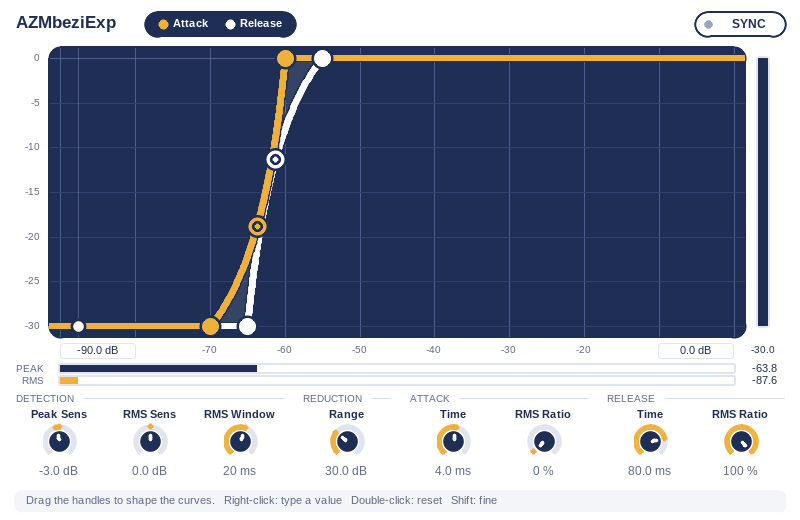

# AZMbeziExp

カーブ編集式のエキスパンダーです。バックグラウンドノイズなどの小さな音を抑えることができます。

## 特長

- 音量の上昇（Attack）と下降（Release）にそれぞれカーブを設定できます。カーブは制御点1つの2次ベジェで、強さを1つの値で決めます。
- Peak と RMS の混合比（RMS Ratio）と、ゲインの平滑化時間を Attack・Release で独立して調整できます。
- 左右に同じゲインを掛けるため、ステレオイメージは変わりません。ゲインは 0 dB 以下（減衰のみ）です。
- フルバンド処理で、ルックアヘッドによる遅延はありません。
- 検知レベルの縦棒とカーブの発光で、いまどのレベルでどちらのカーブが使われているかを確認できます。
- BYPASS では約 5 ms のクロスフェードで切り替わります。

## 注意事項

- REAPER のトラックルーチング上はステレオ入力を前提としています。他 DAW における ysfx 等を使用したモノラルトラック上の挙動は未確認です。
- 旧バージョンで保存したプリセットやオートメーションは引き継がれません（[旧バージョンからの変更](#旧バージョンからの変更)を参照）。
- 音声がプラグインに届いていれば停止中も動作しますが、ホスト側が停止中の処理を中断する場合はその限りではありません。
- ホスト側の FX バイパスは BYPASS とは別です。その間の処理の継続はホストに依存します。

## 導入

JSFX に対応したホストのエフェクト用フォルダに [`jsfx/AZMbeziExp.jsfx`](jsfx/AZMbeziExp.jsfx) をコピーし、ステレオトラックにエフェクトとして追加します。フォルダの場所や追加方法は、使用するホストの案内を参照してください。

## 使い方

1. 歌声を再生し、グラフ上の縦棒（検知レベル）を見ながら Attack の Open と Range、Release の Close と Range を調整します。
2. 曲線上の点（またはグラフ下の Curve 欄）で開き方を調整します。Attack は入り、Release は語尾を聴きながら設定します。
3. グラフ下の段の右端（メーターの下）にある REDUCTION 欄で最大減衰量（リダクション下限）を決め、`RMS CONTROL` を開いて検知と平滑化時間を調整します。

処理の詳細は [アルゴリズム](docs/algorithm.md) を参照してください。

## 画面と操作

グラフの横軸は検知レベル（dB）、縦軸はゲイン（dB）です。山吹色が Attack、白が Release です。

**カーブの決め方（基準＋相対ゲイン）**: Attack は **Open** を基準に、そこから **Range** dB 下が Close です（Close = Open − Range）。Release は **Close** を基準に、そこから **Range** dB 上が Open です（Open = Close + Range）。基準のハンドル（Attack の Open、Release の Close）をドラッグするとカーブ全体が横へ動き、もう一方のハンドルは Range を変えます。Release の Open は 0 dB を超えません。曲線の中点にあるハンドルは斜めにドラッグし、右下方向（＋）で後から開き、左上方向（−）で早く開きます。ダブルクリックまたは Ctrl+クリックで既定値に戻します。右側の縦バーは実ゲインを示します。

**検知レベルの縦棒**: グラフ上の 2 本の縦棒が、Attack 側と Release 側それぞれの検知レベル（Peak と RMS を各 RMS Ratio で混合した値）を示し、横へ動きます。色は各カーブと同じ（Attack は山吹色、Release は白）で、カーブと同じように光り、カーブより後ろに描かれます。文字などの表示はなく、棒の見た目は常に一定です。棒がグラフの左右の端に近づくとフェードアウトし、範囲外では表示されません。

**カーブの発光**: いま目標ゲインを決めている側（傾き検知で選ばれたカーブ）が光ります。切り替えは約 2 ms の時定数でなめらかに行います（SYNC On のときは Attack カーブが光ります）。そのカーブの検知レベルが横軸の範囲外にあるときは光りません（縦棒と同じく、端に近づくと弱まります）。縦棒の光もグラフの外へははみ出しません。

**横軸の範囲**: 使用中のカーブの最小 Close と最大 Open から、それぞれ 10 dB 外側まで自動で設定されます。ハンドルや欄をドラッグしている間は動かず、離すとなめらかに追従します。

**REDUCTION（最大減衰量。グラフの縦軸の下限）**: グラフ下の段の右端、リダクションメーターの下にある REDUCTION 欄（例: −60 dB）で設定します。グラフの右隣の白い縦バーは現在のゲインを示します。軸の数字はグラフの枠内に収めています。他の欄と同じくドラッグ（Shift で微調整）、クリックで数値入力ができます（0〜96 dB、入力は絶対値）。最大減衰量でもあり、音も変わります。

ヘッダー右端の **BYPASS** を On にすると、処理を通さず入力をそのまま出力します（約5 msでクロスフェード。検知は継続）。

**SYNC** を On にすると Release にも Attack カーブを使います。Release カーブの設定は保持され、Off にすると戻ります。

### RMS CONTROL

グラフ下の **RMS CONTROL** の見出しの矢印をクリックすると、つまみのセクションを開閉します（開閉状態は保存されます）。既定では閉じた状態で起動します。閉じるとグラフが広がります。

| グループ | つまみ | 内容 |
| --- | --- | --- |
| DETECTION | Sens | RMS の感度。−24〜+24 dB、既定 +6 dB |
| DETECTION | Window | RMS の平均時間。1〜200 ms、既定 60 ms |
| ATTACK | RMS Ratio | Attack 用の混合比。0% は Peak、100% は RMS。既定 15% |
| ATTACK | Smoothing Time | ゲインが上がるときの平滑化時間。0.1〜100 ms、既定 4 ms |
| RELEASE | RMS Ratio | Release 用の混合比。0% は Peak、100% は RMS。既定 75% |
| RELEASE | Smoothing Time | ゲインが下がるときの平滑化時間。0.1〜500 ms、既定 120 ms |

Peak は感度調整なし（0 dB 固定）です。つまみやハンドルはドラッグ、ホイール、右クリックでの数値入力ができます。Shift は微調整、ダブルクリックまたは Ctrl+クリックは既定値へのリセットです。

### カーブ欄

グラフ下の段に、Attack（山吹色）と Release（紺）の **Curve／基準／Range** の数値欄があります。基準は Attack が Open、Release が Close です。Range 欄は相対ゲインなので配色を変え、Attack は「Range ▼ −10.0 dB」、Release は「Range ▲ +15.0 dB」と向きの矢印と符号を付けて表示します。ドラッグ（Shift で微調整）で変更でき、クリックすると数値を入力できます（Range は入力した値の絶対値を使います）。Curve は −100〜+100%（0% は直線）で、既定は Attack が +60%・Open −55 dB・Range 10 dB（Close −65 dB）、Release が −60%・Close −55 dB・Range 15 dB（Open −40 dB）です。SYNC が On の間、Release の欄は薄く表示され、操作できません。SYNC の既定は Off です。

### 旧バージョンからの変更

スライダーの並びと一部の意味（Attack の Close／Release の Open が Range になった、Meter Min／Max と Time つまみの統合など）が変わったため、旧バージョンで保存したプリセットやオートメーションは引き継がれません。
