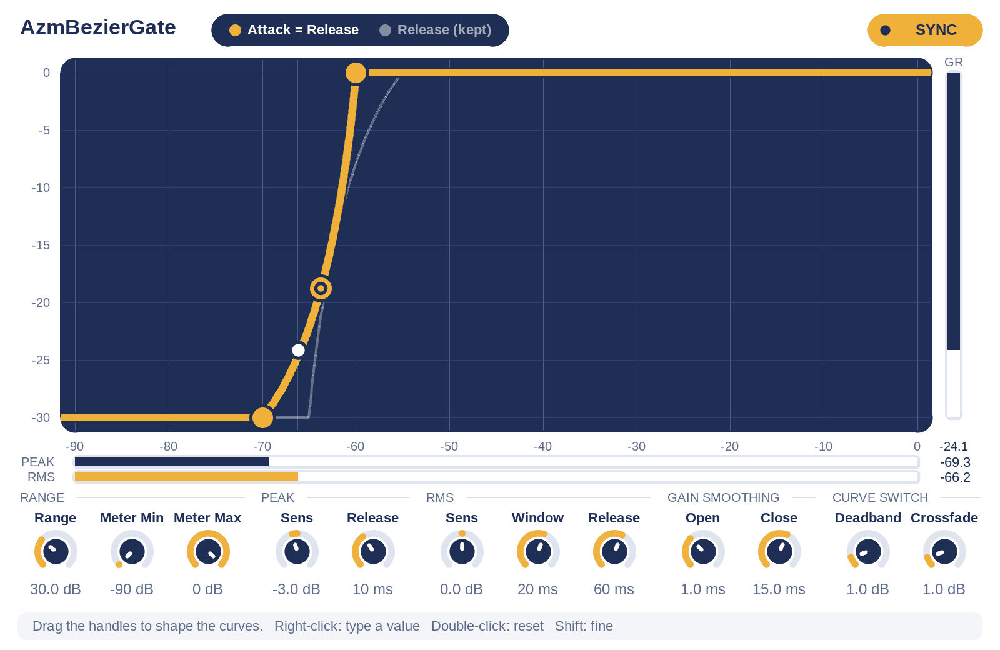

# AzmBezierGate

歌声の入り方や語尾を自然に整えるための、カーブ編集式ゲート／エキスパンダーです。REAPER の JSFX として試作しています。

> **試作段階**：試作版を [`jsfx/AzmBezierGate.jsfx`](jsfx/AzmBezierGate.jsfx) に置いています。グラフ上のハンドルでカーブを編集するグラフィック UI を備えています。仕組みの詳しい解説は [`docs/algorithm.md`](docs/algorithm.md) にあります。REAPER 本体での動作確認はこれからで、仕様や既定値、UI は聴きながら・使いながら見直す前提です。


*オフラインの JSFX エミュレータ（ysfx）で描画した画面です（既定値で、入力が約 -63 dB のとき）。REAPER 本体では、フォントなどの見え方が多少異なる可能性があります。*

## 目指すもの

- 小さなノイズを抑えつつ、歌い出しが「プチッ」「サッ」と不自然に入る感じを減らす。
- MDWEQ5 のように、グラフを中心としたシンプルで直感的な UI にする。
- 入力レベルに対する開き方を、固定のニーではなく、点とハンドルを使った曲線で調整する。ベジェ曲線は候補で、操作しやすさを優先する。
- 単純なオン／オフや固定のアタック・リリースだけでなく、音の変化に自然に寄り添うような時間的な追従を探る。オプトコンプの滑らかさは操作感・聴感上のイメージであり、回路の再現が目的ではない。
- スペクトル分割や AI 処理は使わず、フルバンドのゲイン制御を基本とする。

## 操作のイメージ

グラフの横軸は検知した入力レベル、縦軸は適用するゲイン／減衰量とする案です。小さい音では抑え、大きい音では全開にし、その間の開き方を曲線で調整します。現在の検知レベルと実際のゲインもグラフ上に表示します。

- **閉じるレベル／全開レベル**：曲線の両端。
- **カーブ形状**：両端の間での開き方。
- **Range／Floor**：閉じたときの最大減衰量。完全に無音にせず、少し残すこともできる。
- **アタック／リリースの2本のカーブ**：レベルが上がっていくときは Attack、下がっていくときは Release のカーブに沿ってゲインが動く。Attack を左（低いレベル側）に置くと、小さい音から先に開き、戻るときは早めに閉じ始める。右に置くと、2本の間でゲインを保持する（ヒステリシス）。同期ボタンで、一時的に2本を同じ形にできる。

曲線はレベルに対する目標ゲインを決めるものです。入力やゲインが時間とともにどう変化するかは別途扱います。UI でどのパラメータを見せるかは、試作して使い心地を確認してから決めます。

## Peak / RMS の並列検知案

TDR Kotelnikov の Peak と RMS のリリースをヒントに、異なる時間特性の検知器を並列に使う案です。Kotelnikov の動作を再現するものではありません。

```text
入力 ─┬→ Peak 検知 → Peak Release ─┐
      └→ RMS 検知  → RMS Release  ─┴→ 組み合わせ → カーブ → ゲイン → 出力
```

- **Peak**：歌い出しなどの瞬間的な変化を素早く捉える。
- **RMS**：短い時間の平均的なエネルギーを見て、持続中の開き具合を安定させる。
- それぞれのリリースを調整し、検知レベルとゲインの動きを見ながら聴感を確かめる。

初期案は、感度を調整した２つの検知値の大きい方を採用する方法です。ただし、突発ノイズでも開くことや、検知器同士の切り替わりが不自然になることが懸念されます。組み合わせ方、検知感度、RMS の平均時間、必要なゲイン平滑化は試作時に検討します。

## 考慮事項

- 検知したらすぐ反応を始めたい一方、ゲインの急変はクリックや歪みの原因になります。滑らかさと歌い出しの保持は両立の仕方を聴きながら探ります。
- ルックアヘッドは将来の候補です。歌い出しを捉えやすくなりますが、配信やモニターに遅延が加わります。初期案はルックアヘッドなしです。
- 歌声と同時に鳴るノイズだけを分離して消すものではありません。小さな声や息遣いを残すほど、ノイズも残りやすくなります。
- 元の信号を分岐し、同じ波形を逆相で足して打ち消す方式は、その割合に応じてゲインを下げるのと等価です。初期実装では逆相の並列経路を使わず、直接ゲインを制御する想定です。

## 試作版 JSFX の使い方

### 導入

1. REAPER の `Options > Show REAPER resource path in explorer/finder...` で開くフォルダの `Effects` に、[`jsfx/AzmBezierGate.jsfx`](jsfx/AzmBezierGate.jsfx) をコピーする。
2. トラックの FX に **JS: AzmBezierGate** を追加する。

### 画面と操作

白・紺・山吹色を基調にした、彩度を抑えたカスタム UI です。ウィンドウの大きさに合わせて拡大縮小します。上のグラフでカーブを作り、下のつまみで検知の感度や時間、レンジを整えます。

**グラフ（中央）**

- 横軸は検知した入力レベル(dB)、縦軸はゲイン(dB)。紺のパネルに、山吹色が Attack、白が Release のカーブを太い線で描く。2本の間は薄く塗って示す。
- 各カーブにハンドルが3つある。両端の塗りつぶした丸が **Close** / **Open**（レベルの位置）、中に点のある輪が **Shape**（曲線の膨らみ）。ドラッグして動かす。
- 縦軸の範囲は Range に、横軸の範囲は Meter Min / Meter Max に合わせて変わる。表示範囲の外に出たハンドルは、グラフの端に薄い輪で表示される。その状態でもドラッグできる。
- **白い点（紺の縁取り）**は、いまの検知レベルと実際のゲイン。ゲインは Gain Smoothing で平滑化されるため、カーブの少し後ろを追う。
- 左上の凡例と右上の **SYNC** は、色の対応と Sync の状態を示す（後述）。

**メーター**

- グラフの下に、Peak（紺）/ RMS（山吹色）の検知レベル（感度を調整した後の値）を細いバーと数値で表示する。バーはグラフの横軸と同じ目盛りで並んでいるので、検知レベルとカーブの位置を見比べられる。
- グラフの右の縦バー **GR** は、現在かかっている減衰量。グラフの縦軸（ゲイン）と同じ目盛り。
- 右下の数値は、上から GR（dB）、Peak、RMS。

**つまみ（下段）**

| グループ | つまみ | 内容 |
| --- | --- | --- |
| RANGE | Range | 閉じたときの最大減衰量。グラフの縦軸の範囲も決める。 |
| RANGE | Meter Min / Meter Max | グラフの横軸と Peak / RMS メーターが表示するレベルの範囲。表示だけに影響し、音は変わらない。10 dB 以上離れるように保たれる。 |
| PEAK | Sens / Release | Peak 検知の感度と、検知値が下がる遅さ。 |
| RMS | Sens / Window / Release | RMS 検知の感度、平均時間、検知値が下がる遅さ。 |
| GAIN SMOOTHING | Open / Close | ゲインが開くとき・閉じるときの平滑時間。 |
| CURVE SWITCH | Deadband / Crossfade | 上がる・下がるの切り替えの鈍さ（0〜10 dB。下記）。Attack が左のときだけ効く。 |

最下段の帯には操作のヒントが出ます。ハンドルやつまみにマウスを乗せると、その説明に切り替わります。

**操作**

| 操作 | 動作 |
| --- | --- |
| ハンドルをドラッグ | Close / Open は横方向だけ動き、レベルの位置を変える。Shape は曲線の膨らみを変える。Close は Open より 0.1 dB 以上低く保たれる。 |
| つまみをドラッグ | 上・右へのドラッグで増え、下・左で減る。 |
| 右クリック | ハンドルやつまみの値を、数字で直接入力する。Enter で確定、Esc で取り消し。入力欄の外をクリックしても確定する。 |
| マウスホイール | ハンドルやつまみの上で、少しずつ値を変える。 |
| Shift を押しながら | ドラッグやホイールが微調整になる。 |
| ダブルクリック / Ctrl+クリック | 既定値に戻す。 |
| **SYNC** をクリック | Sync Attack / Release の On / Off を切り替える（下記）。 |

### アタック／リリースのカーブと Sync

カーブは「入力レベル(dB) → ゲイン(dB)」の対応です。Attack と Release の2本があり、名前どおりに使い分けます。

- **レベルが上がっていくとき**は、**Attack** のカーブに沿ってゲインが動く（小さい音から持ち上がるときのしきい値）。
- **レベルが下がっていくとき**は、**Release** のカーブに沿ってゲインが動く（大きい音から下がるときのしきい値）。
- 左右どちらに置いても、この役割は変わらない。置き方で変わるのは、2本の間の動きだけ。

| 置き方 | 動き |
| --- | --- |
| Attack が左（既定値。Attack -70 / -60 dB、Release -65 / -55 dB） | 小さい音から先に Attack で開く。下がるときは Release に沿って、開いたときより高いレベルから閉じ始める。ゲインは2本のカーブの間でループを描く。 |
| Attack が右 | 2本の間（グラフで薄く塗った帯）にいる間は、ゲインを保持する（ヒステリシス）。上がるときは Attack まで、下がるときは Release まで動かないと変化しない。 |

上がる・下がるが細かく入れ替わる音（息や声の揺らぎ）では、ゲインが2本のカーブの間を行き来して「バチバチ」しやすくなります。Attack が左のとき、これを下段の **CURVE SWITCH** の2つのつまみ（0〜10 dB、既定値はどちらも 1 dB）で抑えています。

- **Deadband（不感帯）**：上がる・下がるを切り替えるのは、レベルが直前の頂点（谷）から Deadband 以上逆向きに動いたとき。それより小さな揺れでは向きを変えず、ゲインはそのまま保持する。
- **Crossfade**：向きが切り替わったあと、目標を Attack から Release（またはその逆）へ、レベルが Crossfade 動く間にゆるやかに移す。目標が飛び移らない。0 dB にすると、ほぼ瞬時に切り替わる。

調整の目安です。

- 細かい「バチバチ」が残るときは、Deadband を上げる（揺れの幅より少し大きく）。上げすぎると、ピークのあとに閉じ始めるのが遅れ、そのあと一気に閉じる。
- 向きが切り替わったときの段差（「ブツッ」）が気になるときは、Crossfade を上げるか、Gain Smooth Open を長くする。
- 既定値の 1 dB は控えめな値です。3 dB にすると、細かい揺れをより強く抑えられますが、ピークのあとに閉じ始めるのが、その分遅れます。

実際のゲインは、さらに Gain Smoothing でなだらかになります。この2つは、Attack が右のときと Sync が On のときは使いません。動きの詳細と測定結果は [`docs/algorithm.md`](docs/algorithm.md) の 3 章にあります。

**Sync Attack / Release** は、一時的なモードです。

- On の間は、Release の代わりに Attack の値を使う。2本のカーブが重なるので、ゲインは1本のカーブに沿って動き（上がるときも下がるときも同じ）、グラフには山吹色のカーブと Attack のハンドルだけが出る。別に調整してあった Release のカーブは、薄い白い線で残る（凡例は「Release (kept)」）。
- Release の設定は書き換えない。Off に戻すと、Sync を入れる前に調整していた Release がそのまま戻る。プロジェクトやプリセットにも、Release の値はそのまま保存される。
- On の間に Release の値が変わっても（オートメーションなど）、値は保存されるが、音には反映されない。



*Sync が On のときの画面（入力が約 -66 dB）。山吹色の太いカーブが Attack = Release で、別に調整してあった Release は薄い白い線で残っている。*

### パラメータ

下表は JSFX 内のパラメーター（スライダー）の一覧です。普段は画面上のグラフやつまみで操作します。REAPER の標準（generic）UI にはスライダーを表示しませんが、パラメーターとしては残してあるため、オートメーションなどにも使える想定です（REAPER 本体では未確認）。

| パラメーター | 範囲 | 既定値 | 内容 |
| --- | --- | --- | --- |
| Range (dB) | 0〜96 | 30 | 閉じたときの最大減衰量（2本のカーブで共通）。グラフの縦軸の範囲も決める。 |
| Attack Curve Close (dB) | -90〜0 | -70 | 上がっていくときに使うカーブ（Attack）の Close。このレベル以下で Range 分だけ減衰する。 |
| Attack Curve Open (dB) | -90〜0 | -60 | このレベル以上でゲイン 0 dB（全開）になる。 |
| Attack Curve Shape (%) | -100〜100 | 50 | 0 で直線。＋で Open 付近まで閉じ気味、−で早めに開く。 |
| Sync Attack/Release Curves | Off / On | Off | On の間、Release の代わりに Attack の値を使う（一時的なモード）。 |
| Release Curve Close (dB) | -90〜0 | -65 | 下がっていくときに使うカーブ（Release）の Close（意味は Attack と同じ）。Sync が On の間は使われない。 |
| Release Curve Open (dB) | -90〜0 | -55 | 同 Open。 |
| Release Curve Shape (%) | -100〜100 | -50 | 同 Shape。 |
| Peak Sensitivity (dB) | -24〜24 | -3 | Peak 検知値の感度。＋で小さい音でも開きやすい。 |
| Peak Release (ms) | 1〜500 | 10 | Peak 検知値が下がるときの時定数。 |
| RMS Sensitivity (dB) | -24〜24 | 0 | RMS 検知値の感度。 |
| RMS Window (ms) | 1〜200 | 20 | RMS の平均時間（時定数）。 |
| RMS Release (ms) | 1〜1000 | 60 | RMS 検知値が下がるときの時定数。 |
| Gain Smooth Open (ms) | 0.1〜100 | 1 | ゲインが開く方向の平滑時定数。 |
| Gain Smooth Close (ms) | 0.1〜500 | 15 | ゲインが閉じる方向の平滑時定数。 |
| Meter Min (dB) | -90〜-30 | -90 | グラフの横軸と Peak / RMS メーターの下限。表示だけに影響する。 |
| Meter Max (dB) | -60〜0 | 0 | グラフの横軸と Peak / RMS メーターの上限。表示だけに影響する。 |
| Curve Switch Deadband (dB) | 0〜10 | 1 | 上がる・下がるを切り替えるのに必要な、逆向きのレベルの動き。これより小さい揺れでは、向きもゲインも変えない（Attack が左のときだけ効く）。 |
| Curve Switch Crossfade (dB) | 0〜10 | 1 | 向きが切り替わったあと、目標を Attack ⇔ Release へ移す間のレベルの動き。0 だと、ほぼ瞬時に切り替わる（Attack が左のときだけ効く）。 |

### アルゴリズムの概要

式や図を含む詳しい解説は [`docs/algorithm.md`](docs/algorithm.md) にあります。ここでは要点だけ示します。

- 検知は L/R の絶対値の大きい方（ステレオリンク）で行い、同じゲインを両チャンネルにかける。ルックアヘッドはなく、遅延は加わらない。
- **Peak** は即時アタック＋指数リリース。**RMS** は2乗平均の1次平滑＋リリースで、正弦波ではピークと同じ値になるよう合わせてある。それぞれに感度（dB）をかけ、大きい方を検知レベルとする。
- **カーブ**は Close〜Open を 0〜1 に正規化し、制御点を1つ持つ2次ベジェ曲線で結ぶ。Shape が制御点の位置にあたる。逆算は閉じた式で、反復計算はない。
- **上がる／下がるの判定と目標ゲイン**：Attack が左のとき（既定）は、検知レベルが上がっているか下がっているかを、Deadband（既定 1 dB）の不感帯付きで判定する。上がっている間は Attack、下がっている間は Release のカーブを目標とし、向きが変わった直後は、レベルが Crossfade（既定 1 dB）動く間に目標を一方から他方へ移す。ゲインは、上がっている間は開く方向（Gain Smooth Open）にだけ、下がっている間は閉じる方向（Close）にだけ、目標へ動く。Attack が右のときは、2本のカーブの間でゲインを保持し、下回れば開く方向、上回れば閉じる方向へ動かす。
- **ゲイン平滑**は dB の領域の1次平滑で、開く方向と閉じる方向で時定数を分けている。
- 再生開始時（JSFX の初期化後の最初のサンプル）は、そのときの検知レベルに対応するゲイン（2本のうち小さい方）から始める。
- **Sync** は、使うカーブを Attack に切り替えるだけで、Release の設定は書き換えない。

### 実装メモ

- スライダーの番号と並びは、保存済みプロジェクトとの互換のため変えない（追加は末尾）。
- GUI（`@gfx`）はオーディオ処理とは別のスレッドで動く。そのため GUI は DSP の内部状態を直接書き換えず、スライダーの値を更新して「再計算してほしい」というフラグを立てるだけにしている。係数の再計算は、オーディオ側の `@block` で行う。
- Peak / RMS / 検知レベルのメーター値は、`@sample` が前回の描画以降の最大値を貯め、GUI が描画のたびに読み出して 0 に戻す。ゲイン（GR）は、`@sample` が更新している現在値を GUI が読むだけ。
- Meter Min / Meter Max は表示専用。GUI で変えても、係数の再計算やオートメーションへの書き込みは行わない。
- Sync は、実際に使う Release カーブの値（`e_*`）を Attack か Release のスライダーから選ぶだけで、Release のスライダーは書き換えない。
- 上がる／下がるの判定に使う不感帯とクロスフェード幅は、スライダー 18 / 19（`dead_db` / `fade_db`）の値から、`update_coefs()` が `dir_dead` / `dir_fade` に写す。これらのスライダーを追加する前に保存したプロジェクトでは、既定値の 1 dB で読み込まれる（それまでは 3 dB の固定値だった）。

### 未実装

ルックアヘッド、検知値の組み合わせ方の切り替え、サイドチェイン。

### 検証状況

オープンソースの JSFX インタプリタ（ysfx）で、描画とマウス・キー入力を再現してオフライン検証しました（今回の変更分を含む）。検証用のスクリプトは、このリポジトリには含めていません。

- **処理（DSP）**：静的なカーブが計算どおりになること。Attack = 上がるとき、Release = 下がるとき、という役割が、Attack が左でも右でも名前どおりに働くこと（既定値でゆっくり上げ下げすると、上がるときは約 -70〜-60 dB、下がるときは約 -55〜-65 dB で動く）。別に書いた参照実装（Python）と、Attack が左・右・交差・Sync の各条件で出力が一致すること（差 0.00 dB）。Attack が右のときと Sync が On のときの出力が、変更前の処理と完全に一致すること。Deadband と Crossfade をどちらも 3 dB にすると、これらを固定値にしていた以前の処理と出力が完全に一致すること（48 通りの条件）。Sync を Off に戻すと別々に調整した Release の値がそのまま戻ること。ブロックサイズ（1〜4096 サンプル）が違っても出力が完全に一致すること。サンプルレート（22.05〜192 kHz）で出力が有限で、入力より大きくならないこと。
- **ばたつきの抑え**：8 Hz で揺れるレベルを与え、ゲインの上下の動きの総量を、Deadband と Crossfade の設定ごとに比べた（0 / 0 の単純な切り替え、既定値の 1 / 1 など。結果は [`docs/algorithm.md`](docs/algorithm.md) の 3.5 節）。既定値の 1 dB は、3 dB より抑える効果が弱いことも、この測定で確認した。
- **GUI**：複数のウィンドウサイズと HiDPI 相当の描画、ハンドル・つまみ（CURVE SWITCH の Deadband / Crossfade を含む）のドラッグ、ホイール、右クリックでの数値入力、ダブルクリックでのリセット、Sync の切り替え、Meter Min / Max による表示範囲の変更、ランダムな操作の連続。白・紺・山吹色の配色で、カーブやハンドルがグラフの外にはみ出さないこと。GUI で編集した結果が、スライダーを直接動かしたときと完全に一致すること。GUI が DSP の内部状態を書き換えないこと。

REAPER 本体での確認と聴感確認はこれからです。特に次の点は、実機で確かめる必要があります。

- 非表示にしたスライダーが、オートメーションやパラメーターモジュレーションの対象として使えること。
- GUI での操作が、オートメーションの書き込み（タッチ／ラッチなど）や Undo 履歴に期待どおり残ること。
- HiDPI（Retina）環境で、マウス位置と描画サイズが合うこと。
- 右クリックとダブルクリックの検出（Mac の Ctrl+クリックや、Ctrl / Cmd の扱いを含む）。
- 数値入力中のキー（Enter / Esc / BackSpace / 数字）が、REAPER のショートカットに取られないこと。
- フォント（Arial）での文字の見え方と、つまみの円弧の描画。

## 最初の試作

1. ✅ JSFX としてフルバンドのゲイン制御を実装する。
2. ✅ カーブ（アタック／リリースの2本と、一時的な Sync）、Range、Peak / RMS の検知と各リリースを調整できるようにする。
3. ✅ グラフィック UI で、グラフ上のハンドルによるカーブ編集と、Peak・RMS の検知レベル、実際のゲインの表示ができるようにする。
4. ✅ メーターの表示範囲の調整、つまみ式のコンパクトな UI、右クリックでの数値入力を加える。
5. ✅ Attack = 上がるとき、Release = 下がるとき、という役割を名前どおりにし、向きが入れ替わるときのばたつきを抑える。配色を白・紺・山吹色にする。
6. 歌い出し、持続中、語尾、無音時、突発ノイズで動きを聴き比べる。
7. 聴感と操作感を踏まえて、検知器の組み合わせと UI を整理する。
