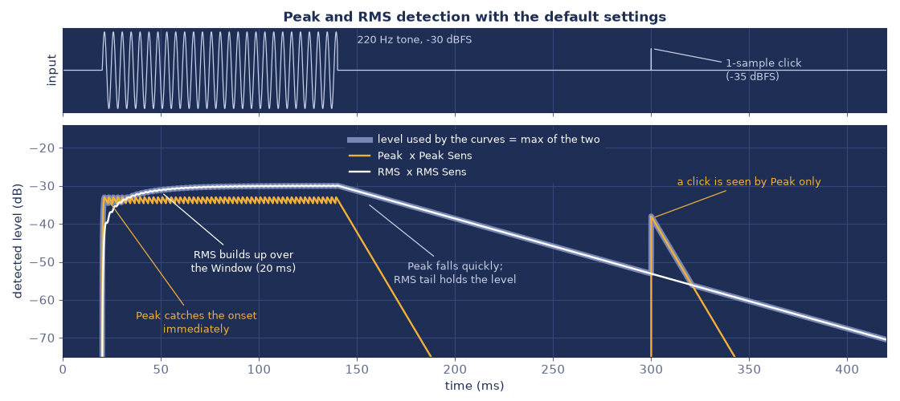
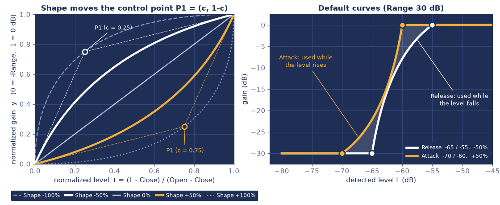
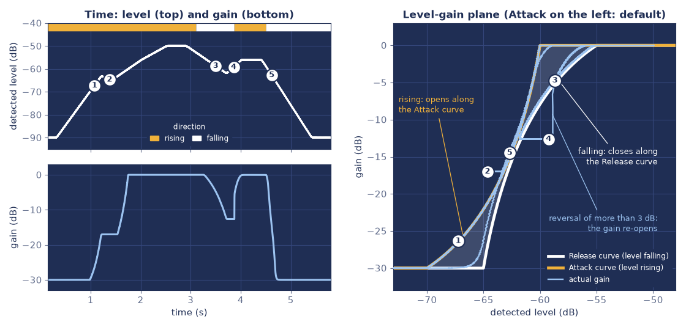
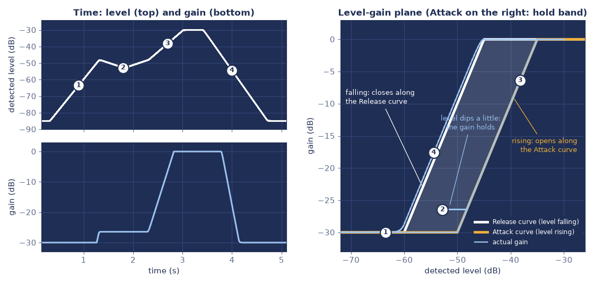
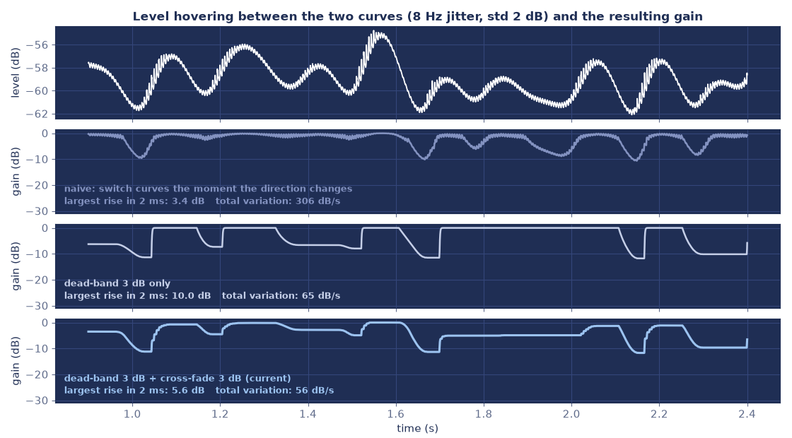

# アルゴリズム解説

AzmBezierGate の音声処理の仕組みを、[`jsfx/AzmBezierGate.jsfx`](../jsfx/AzmBezierGate.jsfx) の変数名と対応させながら説明します。使い方は [README](../README.md) を参照してください。

- 式は GitHub 上で数式として表示されます。
- 図は、この JSFX をオフラインのエミュレータ（ysfx）で実際に動かして作ったものです（図中の文字は英語）。色は画面に合わせてあり、山吹色が Attack、白が Release です。図 3・図 4 の元になった実行では、2 章の式で計算したカーブの値が JSFX の使った値と一致することも確かめています。
- 処理は `@sample` ブロックで1サンプルごとに行います。ルックアヘッドはなく、遅延は 0 です。

## 0. 全体の流れ

```text
入力 L/R
  │
  ① ステレオリンク      a = max(|L|, |R|)
  │
  ├─ ② Peak 検知        瞬間の山を素早く捉える      … Peak Sens / Peak Release
  └─ ③ RMS 検知         短い時間の平均を見る        … RMS Sens / Window / Release
  │
  ④ 大きい方を採用      dB に変換 → 検知レベル ℓ
  │
  ⑤ カーブ評価          ℓ → ゲイン（Attack と Release の2本のカーブ）
  │
  ⑥ 上昇／下降と目標    上がるときは Attack、下がるときは Release に従う
  │
  ⑦ ゲイン平滑          Open / Close の時定数（dB の領域）
  │
  ⑧ ゲイン適用          L/R に同じゲインを掛ける → 出力
```

時定数 $\tau$（秒）は、サンプルレート $f_s$ を使って1サンプルあたりの係数に直して使います（`decay_of`）。1サンプルより短い時定数は1サンプルとして扱います。

$$
d(\tau) = e^{-1/(\tau f_s)},\qquad k(\tau) = 1 - d(\tau)
$$

主な記号とコードの対応です。

| 記号 | 意味 | コード |
| --- | --- | --- |
| $a$ | 左右の絶対値の大きい方 | `a` |
| $p$ | Peak 検知値 | `pk` |
| $m$ | 入力の2乗の平均 | `msq` |
| $r$ | RMS 検知値 | `rms_env` |
| $\ell$ | 検知レベル（dB） | `lvl_db` |
| $g_A,\ g_R$ | Attack / Release カーブが返すゲイン（dB） | `la`, `lr` |
| $T$ | 目標ゲイン（dB）。Attack が左のときに使う | `tgt` |
| $\uparrow$ | レベルが上がっている最中なら 1、下がっている最中なら 0 | `dir_up` |
| $\ell_{ext}$ | 直近の極値（上がっている間は最大、下がっている間は最小） | `lvl_ext` |
| $s$ | 目標を Release（0）から Attack（1）へ寄せる割合 | `dir_s` |
| $D,\ F$ | 不感帯の幅、クロスフェードの幅（どちらも 3 dB の固定値） | `dir_dead`, `dir_fade` |
| $G$ | 現在のゲイン（dB） | `gdb` |

## 1. レベル検知（①〜④）

### 1.1 ステレオリンク

$$
a[n] = \max\bigl(\lvert x_L[n]\rvert,\ \lvert x_R[n]\rvert\bigr)
$$

検知は左右をまとめて1つだけ行い、同じゲインを両チャンネルに掛けます。左右で別々に開閉すると、ステレオの定位が揺れてしまうためです。

### 1.2 Peak 検知

$$
p[n] = \max\bigl(a[n],\ d_p\,p[n-1]\bigr),\qquad d_p = d(\tau_p)
$$

$\tau_p$ は Peak Release です。

- 上がるときは即時で、入力にそのまま追いつきます。
- 下がるときは指数的に落ちます。時間 $\tau_p$ ごとに $1/e$ 倍（約 −8.7 dB）になるので、Peak Release が 10 ms なら 10 ms あたり約 8.7 dB です（図 1 の実測で 8.69 dB）。
- 波形のサンプル値のピークで、トゥルーピーク（オーバーサンプリング）ではありません。
- 周期的な信号では、山と山の間で少し落ちるため、検知値が山ごとに細かく揺れます（図 1 の山吹色の線）。Peak Release が長いほど揺れは小さくなります。

### 1.3 RMS 検知

$$
m[n] = m[n-1] + k_w\bigl(a[n]^2 - m[n-1]\bigr),\qquad k_w = k(\tau_w)
$$

$$
r[n] = \max\bigl(\sqrt{2\,m[n]},\ d_r\,r[n-1]\bigr),\qquad d_r = d(\tau_r)
$$

RMS Window を $\tau_w$、RMS Release を $\tau_r$ とします。

- $m$ は入力の2乗を1次ローパス（指数窓）で平均したものです。
- 振幅 $A$ の正弦波の2乗平均は $A^2/2$ になります。そこで $\sqrt{2m}$ を使い、正弦波なら Peak と同じ $A$ になるように揃えています。
- 上がるときは Window に従います。
- 下がるときは、Window による低下（振幅で見て時定数 $2\tau_w$）と、Release の指数減衰のうち**遅い方**に従います。実質の時定数は $\max(2\tau_w,\ \tau_r)$ です。既定値（Window 20 ms / Release 60 ms）では Release が支配的で、10 ms あたり約 1.45 dB（= 8.69 dB / 60 ms）下がります。Window を長くして $2\tau_w$ が $\tau_r$ を超えると、Release を短くしても下がり方は変わりません。

### 1.4 感度と合成

$$
\ell = 20\log_{10}\max\bigl(g_p\,p,\ g_r\,r\bigr),\qquad g_p = 10^{S_p/20},\quad g_r = 10^{S_r/20}
$$

$S_p$, $S_r$ は Peak / RMS Sensitivity（dB）です。＋にするほど検知レベルが高く見え、小さい音でも開きやすくなります。

- Peak は歌い出しや突発音に即座に反応します。RMS は短い時間の平均で持続中の値を安定させ、語尾では Release が下がり方を緩やかにします。大きい方を採用するので、立ち上がりは速く、持続中と語尾は安定します。
- 既定値は Peak −3 dB / RMS 0 dB です。正弦波では Peak 側が 3 dB 低くなるので、定常部は RMS が決め、立ち上がりと突発音のときだけ Peak が先に反応します。
- 弱点もあります。図 1 では、単発のクリック（−35 dBFS）が Peak だけに映り、検知レベルを一瞬持ち上げています（RMS 側に出る分は約 −62 dB）。このレベルが Close を上回るなら、ゲインは開く方向に動きます。
- dB の基準は 0 dBFS（振幅 1.0）です。`log` が発散しないよう、検知値には −240 dB（振幅 $10^{-12}$）の下限があります。



*図 1：220 Hz の正弦波バースト（−30 dBFS、120 ms）と、単発のクリックに対する検知。既定値のとき。山吹色が Peak、白が RMS（どちらも感度を掛けたあと）、太い線が検知レベル（大きい方）。*

## 2. カーブ（⑤）

### 2.1 正規化と Range

Close / Open（dB）で検知レベルを 0〜1 に正規化します。Range は $R$ dB とします。

$$
t = \frac{\ell - \mathrm{Close}}{\mathrm{Open} - \mathrm{Close}}
$$

- $t \le 0$ のとき、ゲインは $-R$ dB。完全に閉じた状態です。
- $t \ge 1$ のとき、ゲインは 0 dB。全開です。
- $0 < t < 1$ のとき、次のベジェ曲線でつなぎます。

### 2.2 2次ベジェ曲線と Shape

始点 $P_0 = (0,\ 0)$、終点 $P_2 = (1,\ 1)$、制御点 $P_1 = (c,\ 1-c)$ の2次ベジェ曲線です。

$$
x(u) = 2c\,u(1-u) + u^2,\qquad y(u) = 2(1-c)\,u(1-u) + u^2,\qquad 0 \le u \le 1
$$

$$
c = 0.5 + 0.5\cdot\mathrm{clamp}\!\left(\frac{\mathrm{Shape}}{100},\ -0.999,\ 0.999\right)
$$

$x(u) = t$ になる $u$ を求め、そのときの $y$ からゲインを決めます。

$$
\mathrm{gain\ [dB]} = -R\,\bigl(1 - y(u)\bigr)
$$

- 制御点 $P_1$ は、点 $(0,\ 1)$ と点 $(1,\ 0)$ を結ぶ線 $x + y = 1$ の上を動きます。Shape 0% では $c = 0.5$ となって $P_1$ が対角線 $y = x$ の上に乗り、曲線は直線になります。
- Shape を＋にすると $P_1$ は対角線の下に下がり、曲線は下に膨らみます。Open の近くまでゲインが上がらず、Open 付近で急に開く「閉じ気味」の形です。
- Shape を−にすると $P_1$ は上に上がり、曲線は上に膨らみます。早めに開く形です。
- ±100% でも $\pm 99.9\%$ に抑えています。これは $c$ がちょうど 0 や 1 になる端を避けるためです。
- $0 < c < 1$ の間は $x(u)$ も $y(u)$ も $u$ に対して単調に増えます。曲線は常に「レベルが上がればゲインも上がる」形で、折り返しやループはありません。



*図 2：左は正規化したカーブ（Shape による変化）。右は既定値の2本のカーブ（Range 30 dB。山吹色が Attack、白が Release）。*

Shape と、Close と Open のちょうど中間のレベル $t = 0.5$ でのゲインの関係です（Range 30 dB の場合）。

| Shape | $c$ | 中間レベルのゲイン |
| --- | --- | --- |
| −100% | 0.0005 | −2.6 dB |
| −50% | 0.25 | −7.9 dB |
| 0% | 0.5 | −15.0 dB |
| +50% | 0.75 | −22.1 dB |
| +100% | 0.9995 | −27.4 dB |

### 2.3 $x(u) = t$ を閉じた式で解く

$x(u) = (1-2c)\,u^2 + 2c\,u$ は $u$ の2次式なので、解の公式で解けます。

$$
u = \frac{-c + \sqrt{c^2 + (1-2c)\,t}}{1-2c} = \frac{t}{c + \sqrt{c^2 + (1-2c)\,t}}
$$

右の形は、分子を有理化したものです。直線になる $c = 0.5$ の場合は $1-2c = 0$ ですが、右の形なら 0 で割らずに $u = t$ が得られます。コードはこの形を使っているので、場合分けも反復計算も要らず、平方根1回で済みます（`curve_db`）。

### 2.4 計算例

既定値（Range 30 dB）で、検知レベルが $\ell = -63$ dB のとき。

| カーブ | 設定 | $t$ | $c$ | $u$ | $y$ | ゲイン |
| --- | --- | --- | --- | --- | --- | --- |
| Attack | −70 / −60 dB、+50% | 0.7 | 0.75 | 0.578 | 0.456 | −16.3 dB |
| Release | −65 / −55 dB、−50% | 0.2 | 0.25 | 0.306 | 0.412 | −17.6 dB |

## 3. 上がるときと下がるときで、別のカーブを使う（⑥）

### 3.1 Attack と Release の役割

2本のカーブは、名前どおりに使い分けます。

- **Attack**：レベルが**上がっていく**ときに従うカーブ。小さい音から持ち上がるときのしきい値です。
- **Release**：レベルが**下がっていく**ときに従うカーブ。大きい音から下がるときのしきい値です。

左右のどちらに置いても、この役割は変わりません。置き方で変わるのは、2本の間でゲインがどう動くかです。

カーブは単調増加なので、同じレベルでは、左側（Close / Open が低いレベル側）のカーブの方が大きなゲインを返します（Shape が大きく違って2本が交差する場合を除く）。そこで、1サンプルごとに、現在のレベルで2本のカーブが返すゲイン $g_A$, $g_R$ を比べて、動かし方を切り替えます。

| 置き方 | 判定 | 動き |
| --- | --- | --- |
| Attack が左（既定値） | $g_A > g_R$ | 小さい音から先に開き、下がるときは早めに閉じ始める。上がるときと下がるときで、別の道を通る（3.2） |
| Attack が右 | $g_A \le g_R$ | 2本の間では、ゲインを保持する（3.3） |

既定値（Attack −70 / −60 dB、Release −65 / −55 dB）は Attack が左です。Shape が逆向きなので、2本の間隔はレベルによって変わりますが、どのレベルでも $g_A \ge g_R$ です。

### 3.2 Attack が左のとき（既定値）

上がっている間は Attack、下がっている間は Release のカーブを目標にします。Attack は左にあるので小さい音から先に開き、Release は右にあるので、下がるときは、開いたときより高いレベルから先に閉じ始めます。ゲインは、2本のカーブの間をループ状に動きます（図 3）。

#### 上昇／下降の判定

検知レベル $\ell$ が上がっているのか下がっているのかを、2つの状態で追います。

- $\uparrow$（`dir_up`）：上がっている最中なら 1、下がっている最中なら 0。
- $\ell_{ext}$（`lvl_ext`）：直近の極値。上がっている間は最大値、下がっている間は最小値。

1サンプルごとに、次のように更新します。**不感帯**の幅を $D$ とし、3 dB にしています（`dir_dead`）。表にない場合は、何も変えません。

| 状態 | 条件 | 更新 |
| --- | --- | --- |
| 上がっている | $\ell > \ell_{ext}$ | $\ell_{ext} \leftarrow \ell$ |
| 上がっている | $\ell < \ell_{ext} - D$ | $\uparrow \leftarrow 0,\ \ell_{ext} \leftarrow \ell$ |
| 下がっている | $\ell < \ell_{ext}$ | $\ell_{ext} \leftarrow \ell$ |
| 下がっている | $\ell > \ell_{ext} + D$ | $\uparrow \leftarrow 1,\ \ell_{ext} \leftarrow \ell$ |

向きが切り替わるのは、レベルが極値から $D$ 以上逆向きに動いたときだけです。それより小さな揺れでは、向きは変わりません。

#### 目標ゲイン

目標ゲイン $T$（`tgt`）は、Release のゲインから Attack のゲインまでの間の値です。

$$
T = g_R + s\,(g_A - g_R),\qquad 0 \le s \le 1
$$

$s$（`dir_s`）は、目標を Release と Attack のどちらに寄せるかの割合です。

- $s = 0$：目標は Release のゲイン $g_R$
- $s = 1$：目標は Attack のゲイン $g_A$

極値が $\Delta$ dB 更新されるたびに、クロスフェードの幅を $F$（3 dB、`dir_fade`）として、次のように動きます。

- 上がっている間は $s \leftarrow \min(s + \Delta/F,\ 1)$
- 下がっている間は $s \leftarrow \max(s - \Delta/F,\ 0)$

向きが切り替わった直後の $s$ は、前の向きの端（上がり終えたあとなら 1、下がり終えたあとなら 0）にあります。そこからレベルがさらに $F$ だけ動く間に、反対側の端へ移ります。向きが変わっても目標が飛び移らず、**時間ではなくレベルの動きで**滑らかに切り替わります。そのため、速い立ち上がりでも目標は遅れません（レベルが一気に 3 dB 以上上がれば、1サンプルで $s = 1$ になります）。

#### ゲインの動き

上がっている間は開く方向にだけ、下がっている間は閉じる方向にだけ、目標 $T$ に向かって動かします。

| 状態 | 条件 | 動き |
| --- | --- | --- |
| 上がっている | $G < T$ | $T$ に向かって開く（時定数は Gain Smoothing Open） |
| 上がっている | $G \ge T$ | 動かさない |
| 下がっている | $G > T$ | $T$ に向かって閉じる（時定数は Gain Smoothing Close） |
| 下がっている | $G \le T$ | 動かさない |

「動かさない」は、レベルがわずかに戻ったとき（不感帯の内側）に、ゲインが逆向きに動かないようにする役目があります。上がっている最中にレベルが少し下がると、目標 $T$ は下がりますが、ゲインは閉じずに、その高さで保持されます（図 3 の ②）。

図 3 は、既定値（Attack −70 / −60 dB・Shape +50%、Release −65 / −55 dB・Shape −50%、Range 30 dB）で、次のようにレベルを動かした結果です。左上の図の上端の帯は、判定した向き（山吹色が上がっている、白が下がっている）です。右のグラフの薄い青い線が、実際のゲインの軌跡です。

1. レベルが上がっていくとき、ゲインは Attack のカーブ（山吹色）に沿って開きます。
2. 途中でレベルが 2 dB 下がっても（不感帯の内側）、ゲインはその高さで保持されます。
3. 最大値から下がっていくとき、ゲインは Release のカーブ（白）に沿って閉じます。Release は右にあるので、Attack より高いレベルから閉じ始めます。
4. 谷（−62 dB）から 3 dB を超えて上がったので、上がっている状態に切り替わります。谷で止まっていたゲインは、新しい目標へ Gain Smoothing Open の速さで開きます（図では約 7 dB の段差。3.5 節）。
5. 最後に下がっていくとき、ゲインは再び Release のカーブに沿って閉じます。



*図 3：Attack が左のとき（既定値）の動き。左は時間軸（上：検知レベルと、判定した向き。下：ゲイン）、右は「レベル―ゲイン」の平面での軌跡（実際の JSFX の出力）。*

### 3.3 Attack が右のとき

Attack の方が右にある、つまり $g_A \le g_R$ のときは、2本のカーブの間（グラフで薄く塗った帯）に、現在のゲインを収めます。向きの判定は使いません。ゲインが帯のどちら側に出たかで、開くか閉じるかが決まります。

| 状態 | 動き |
| --- | --- |
| $G < g_A$ | $g_A$ に向かって開く（時定数は Gain Smoothing Open） |
| $g_A \le G \le g_R$ | 動かさない（保持） |
| $G > g_R$ | $g_R$ に向かって閉じる（時定数は Gain Smoothing Close） |

- 上がるときは、右側の Attack に押し上げられて開きます。下がるときは、左側の Release に押し下げられて閉じます。開くレベルを閉じるレベルより高くする、普通のゲートのヒステリシスです。
- 帯の中でレベルが揺れても、ゲインは動きません。2本の間隔が広いほど、保持が効く範囲が広がります。

図 4 は、Attack を右に置いた例です（Attack −50 / −35 dB、Release −60 / −45 dB、どちらも Shape 0%、Range 30 dB）。

1. Attack の Close（−50 dB）に届くまで、ゲインは閉じたまま（−30 dB）です。
2. いったん上がってから少し下がっても、2本の間にいる間は、ゲインはその高さで保持されます。
3. また上がって Attack を超えると、Attack のカーブ（山吹色）に沿って開きます。
4. 下がるときは、Release のカーブ（白）に沿って閉じます。右のグラフで、実際のゲイン（薄い青い線）が Release のカーブより少し上にずれているのは、Gain Smoothing Close（15 ms）による遅れです。



*図 4：Attack が右のとき（2本の間で保持）の動き。見方は図 3 と同じ。*

### 3.4 2本が交差するとき、Sync のとき

- Shape を大きく変えて2本が交差するレベルでは $g_A = g_R$ になるので、3.2 の目標は $s$ によらず $T = g_R = g_A$ になります。交差の前後で動かし方（3.2 と 3.3）が切り替わっても、目標は連続しています。3.3 の方では、交差するレベルで帯の高さが 0 になり、そのレベルでは保持が効きません。
- Sync が On のときは、2本のカーブが完全に一致して $g_A = g_R$ になります。どのレベルでも帯の高さが 0 になるので、3.3 の動きで「カーブ1本＋ゲイン平滑」になります。向きの判定は使いません（5 章）。

### 3.5 ばたつきをどう抑えているか

検知レベルは、RMS のわずかな揺れや声の揺らぎ、息の成分などで細かく上下します。Attack が左のとき、上がる・下がるが細かく入れ替わるたびに目標が Attack と Release を行き来すると、ゲインもそれに合わせて2本のカーブの間を往復し、「バチバチ」と聞こえます。そこで、次の3つを組み合わせています。

1. **不感帯（3 dB）**：3 dB より小さい揺れでは、向きを変えない。ゲインは保持される。
2. **クロスフェード（3 dB）**：向きが変わっても、目標をレベルの動きに合わせて滑らかに移す。
3. **Gain Smoothing**：ゲインの段差を、時定数で滑らかにする（4 章。前からあるもの）。

効果は、検知レベルを −62 dB のまわりで、8 Hz・標準偏差 1〜3 dB で揺らして測りました（既定値。入力は基本周波数 180 Hz の有声音風の合成信号）。次の3つの方式を、2つの指標で比べます。

- **単純な切り替え**：不感帯もクロスフェードもなし（上がりと下がりが入れ替わった瞬間に、目標が飛ぶ）。
- **不感帯のみ**：不感帯 3 dB、クロスフェードなし。
- **現行**：不感帯 3 dB＋クロスフェード 3 dB。

指標は次の2つです。

- **総変化量**：ゲインの上下の動きの総量を、1秒あたりに直したもの。小さいほど、ゲインが動き回っていない。
- **2 ms での最大上昇**：2 ms の間にゲインが上がった量の最大値。ゲインの段差の大きさ。

| 揺れ（標準偏差） | 方式 | 総変化量 | 2 ms での最大上昇 |
| --- | --- | --- | --- |
| 1 dB | 単純な切り替え | 375 dB/s | 2.1 dB |
| 1 dB | 不感帯のみ | 26 dB/s | 5.8 dB |
| 1 dB | **現行** | **10 dB/s** | 3.4 dB |
| 2 dB | 単純な切り替え | 306 dB/s | 3.4 dB |
| 2 dB | 不感帯のみ | 65 dB/s | 10.0 dB |
| 2 dB | **現行** | **56 dB/s** | 5.6 dB |
| 3 dB | 単純な切り替え | 253 dB/s | 4.2 dB |
| 3 dB | 不感帯のみ | 115 dB/s | 12.9 dB |
| 3 dB | **現行** | **103 dB/s** | 7.9 dB |

読み方です。

- 単純な切り替えでは、ゲインが検知レベルの細かい揺れに合わせて動き続けます（250〜375 dB/s）。現行では、揺れが 1 dB のとき約 1/37、2 dB のとき約 1/5.5、3 dB のとき約 1/2.5 に減ります。
- 不感帯だけだと、動きは大きく減る一方、不感帯を超えて向きが本当に変わったときに、目標が一度に切り替わって大きな段差が出ます（2 dB のとき 10.0 dB）。クロスフェードを加えると、この段差が約半分（5.6 dB）になり、総変化量も減ります。
- 最大上昇だけを見ると単純な切り替えの方が小さいのは、ゲインが小刻みに動き続けるためで、バチバチが少ないという意味ではありません。2つの指標を合わせて読みます。
- 揺れが大きくなるほど、不感帯を超える反転が増えるので、効果は小さくなります。

図 5 は、揺れが 2 dB のときのゲインの動きです。単純な切り替えでは、ゲインが検知レベルの細かい揺れに追従して細かく振動します。不感帯を入れると保持される区間ができ、クロスフェードを加えると段差が小さくなります。



*図 5：揺れるレベル（8 Hz、標準偏差 2 dB）に対するゲインの動き。上から、検知レベル、単純な切り替え、不感帯のみ、現行（不感帯＋クロスフェード）。*

#### 限界

- 不感帯（3 dB）を超えて本当に向きが変わったときは、新しい目標へ Gain Smoothing の速さで動くので、数 dB の段差が出ることがあります（図 3 の ④。上の測定では、2 ms での最大上昇が 5.6 dB、揺れが 3 dB のときは 7.9 dB）。
- 気になる場合は、Gain Smoothing の時間を長くします。同じ測定で、Open を 1 ms から 5 ms にすると、2 ms での最大上昇は 5.6 dB から 2.1 dB になりました（揺れが 3 dB のときは 7.9 dB から 3.0 dB）。Close を 15 ms から 40 ms にすると、総変化量は 56 dB/s から 43 dB/s になりました（揺れが 3 dB のときは 103 dB/s から 77 dB/s）。
- ピークのあと、ゲインが Release のカーブに完全に従うのは、レベルが頂点から 6 dB（不感帯 3 dB＋クロスフェード 3 dB）下がったあとです。最初の 3 dB の間、ゲインは閉じ始めません。頂点が Release のカーブの傾斜部分に近い、小さい音のときに目立ちます。
- 不感帯とクロスフェードの幅（3 dB）は固定値（`dir_dead` / `dir_fade`）で、聴いて調整する余地があります。

## 4. ゲイン平滑（⑦）

現在のゲイン $G$（dB）を、目標に向けて次のように1次平滑して更新します（`k_open`, `k_close`）。上から順に、開く方向に動かすとき（open）、閉じる方向に動かすとき（close）、動かさないとき（hold）で、どれになるかは 3 章の表で決まります。

$$
G \leftarrow
\begin{cases}
G + k_o\,(T_o - G + \varepsilon) & (\text{open})\\
G + k_c\,(T_c - G - \varepsilon) & (\text{close})\\
G & (\text{hold})
\end{cases}
\qquad k_o = k(\tau_o),\quad k_c = k(\tau_c)
$$

Gain Smoothing Open を $\tau_o$、Close を $\tau_c$ とします。目標は、Attack が左のとき $T_o = T_c = T$、Attack が右のとき $T_o = g_A$ と $T_c = g_R$ です。ゲインは最後に倍率へ直して、両チャンネルに掛けます。

$$
\mathrm{gain} = 10^{G/20}
$$

- 平滑は dB の領域で行います。30 dB の変化でも 3 dB の変化でも、差の $1 - 1/e$（約 63%）を縮めるのにかかる時間は同じ $\tau$ です。
- 開く向きと閉じる向きで時定数を分けられます。既定値は Open 1 ms（歌い出しを逃さない）、Close 15 ms（語尾を滑らかに）です。Open を短くしすぎると、ゲインの急な立ち上がりがクリックとして聞こえることがあります。
- 状態は $G$ そのものなので、保持している間は $G$ が止まり、平滑も働きません。
- $\varepsilon$（コードでは `eps_db`。値は $10^{-9}$ dB）は、目標をほんの少し行き過ぎた点に向かわせるための量です。目標そのものに向かう1次平滑は、目標に無限に近づくだけで到達しません。そこで $\varepsilon$ だけ先を狙うことで、有限の時間で $G$ が目標に届いて止まるようにしています。また、全開（0 dB）に近づく場面で値が限りなく 0 に近づき続け、デノーマル数による負荷が出ることも避けられます。
- ゲインが 0 dB（入力と同じ音量）を超えることは実質ありません。超えても $\varepsilon$ の分だけで、最大 $+10^{-9}$ dB です。

## 5. Sync（一時モード）

Sync は、Release カーブの代わりに Attack の値を使う一時的なモードです。

- 実際に使う Release カーブの値（`e_close`, `e_open`, `e_shape`）を、Sync が On なら Attack の値、Off なら Release のスライダーの値から選びます（`update_coefs`）。
- Release のスライダー（`r_close`, `r_open`, `r_shape`）は書き換えません。そのため、Sync を Off にすれば、別々に調整していた値がそのまま戻ります。プロジェクトやプリセットにも、Release の値はそのまま残ります。
- On の間は2本のカーブが一致して $g_A = g_R$ になるので、3.3 の帯の高さが 0 になり、「カーブ1本＋ゲイン平滑」の動きになります。向きの判定を使う 3.2 の動きにはなりません。
- On の間にオートメーションなどで Release の値が変わっても、値は保存されますが、音には反映されません。

## 6. 初期化と境界条件

| 場面 | 動作 |
| --- | --- |
| 最初のサンプル | JSFX の初期化（読み込み、再生開始など）後の最初のサンプルでは、そのときの検知レベルに対応するゲイン（2本のうち小さい方）から始める。突然の開閉を避ける。 |
| 向きの判定の初期値 | 下がっている状態（`dir_up` = 0）、`dir_s` = 0（目標は Release）、`lvl_ext` = 0 dB から始める。最初のサンプルで小さい方のゲインに合わせることと整合している（Attack が左のとき、小さい方は Release）。 |
| 無音 | 検知値は −240 dB の下限になり $t \le 0$ なので、Range 分だけ閉じる。 |
| Range = 0 | カーブは常に 0 dB なので、素通しになる。 |
| Close ≥ Open | 幅 0.01 dB の急峻な段差として扱う（`max(Open − Close, 0.01)`）。GUI は Close < Open を保つ。 |
| サンプルレート | 時定数は ms で指定し、サンプルレートに合わせて係数に直す。22.05〜192 kHz で動作を確認。 |
| ブロックサイズ | 処理はサンプル単位で、ブロックサイズに依存しない。係数の更新だけがブロックの先頭で行われるので、GUI 操作の反映は最大でも1ブロック分の遅れになる。 |

## 7. GUI との分担

`@gfx`（GUI）は、`@sample`（音声処理）とは別のスレッドで動きます。そのため、次のように分担しています。

- GUI が書き換えてよいのは、スライダーの変数、メーター用の `m_*`（読んだあとに 0 に戻す）、再計算の要求フラグ `ui_dirty` だけです。`pk`、`gdb`、`tgt`、`dir_up`、`dir_s`、`lvl_ext` など DSP の内部状態は書き換えません（GR の表示のために `gdb` を読むだけです）。
- GUI でパラメーターを変えると、スライダーの値を更新してホストに通知し、`ui_dirty` を立てます。係数の再計算は、音声側の `@block` の先頭で行います。
- Peak / RMS / 検知レベルのメーターは、`@sample` が前回の描画以降の最大値を `m_pk`、`m_rms`、`m_lin` に貯め、GUI が描画のたびに読み出して 0 に戻します。GR は最大値を貯めず、GUI が `gdb` の現在値を読みます。
- Meter Min / Meter Max は、グラフの横軸と Peak / RMS バーの範囲を決める表示用の設定です。音の処理には関係しません。

## 8. 計算量

1サンプルあたり、平方根が最大3回（RMS に1回、2本のカーブに各1回）、`log` が1回、`exp` が1回で、あとは四則演算と比較だけです。上昇／下降の判定も、比較と加減算だけです。2本のカーブの逆算に反復計算はありません。ルックアヘッドがないので、遅延は 0 サンプルです。

## 9. パラメーターの効き方（早見）

アルゴリズム上、各パラメーターは次のように効きます。

| パラメーター | 効き方 |
| --- | --- |
| Range | 閉じたときの減衰量。カーブの縦のスケールになるので、同じ Shape でも dB あたりの傾きが変わる。 |
| Close / Open | 開き始めるレベルと、全開になるレベル。右に動かすほど、小さい音が抑えられる。間隔を狭めるとゲートらしい切れの良い動きに、広げると緩やかな動きになる。 |
| Shape | ＋で Open 付近まで閉じ気味、−で早めに開く。 |
| Attack と Release の左右 | Attack が左（既定値）なら、小さい音から先に開き、下がるときは早めに閉じ始める（3.2）。右なら、2本の間でゲインを保持する（3.3）。どちらに置いても、上がるときは Attack、下がるときは Release の位置が基準になる。 |
| 2本のカーブの間隔 | Attack が左のときは、広いほど、開くレベルと閉じ始めるレベルの差が大きくなる。右のときは、広いほど、ゲインを保持する帯が広がる。 |
| Peak Sens / Release | 突発音や立ち上がりでの開きやすさと、その検知値を保つ長さ。 |
| RMS Sens / Window / Release | 持続中の開きやすさ、検知の滑らかさ（Window）、語尾で検知値が下がる遅さ。下がる遅さは $\max(2\tau_w,\ \tau_r)$。 |
| Gain Smoothing Open / Close | ゲインが開く・閉じるときの滑らかさ。長くするほど、上昇／下降が切り替わった直後のゲインの段差も小さくなる（3.5）。 |

## 10. 限界と今後

- フルバンドのゲイン制御です。周波数帯ごとの処理はしません。
- ルックアヘッドがないため、歌い出しの手前を先読みして開くことはできません。その代わり、遅延は加わりません。
- Peak はサンプルピークで、サイドチェインもありません。
- 上昇／下降の判定には、3 dB の不感帯があります。ピークのあと、ゲインが閉じ始めるのは、レベルが 3 dB 下がってからです（3.5）。
- 不感帯を超えて向きが本当に切り替わったときは、ゲインが新しい目標へ Gain Smoothing の速さで動くため、数 dB の段差が出ることがあります。気になる場合は、Gain Smoothing を長くします（3.5）。
- 不感帯とクロスフェードの幅（3 dB）は固定値で、調整用のスライダーはありません。
- 検知器の組み合わせ（現在は大きい方を採用）や、突発ノイズへの対処は、聴き比べながら見直す予定です。
