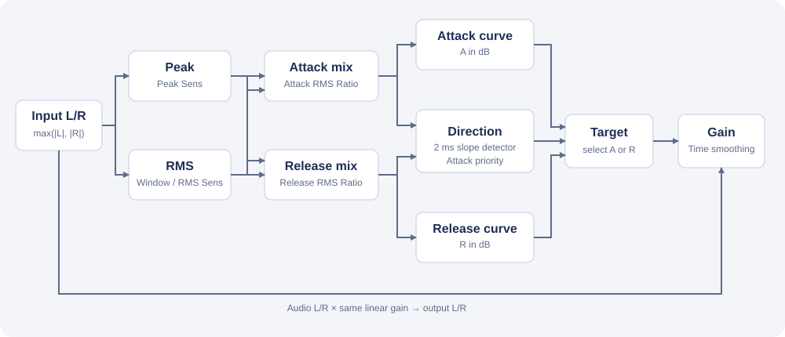
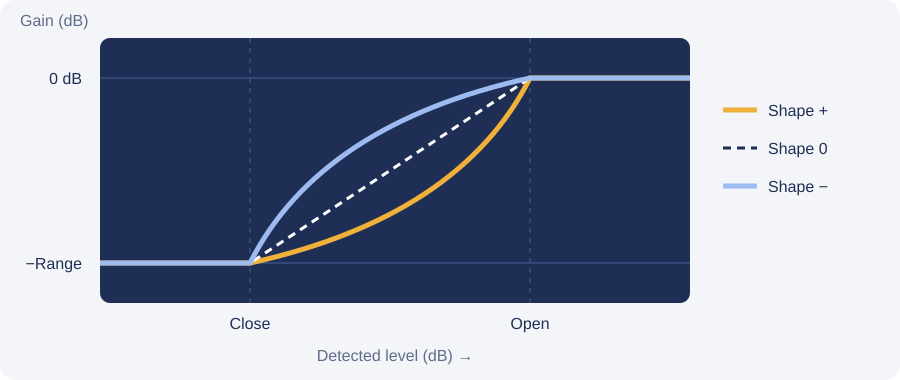

# アルゴリズム

[`jsfx/AzmBezierGate.jsfx`](../jsfx/AzmBezierGate.jsfx) の処理を説明します。図は処理の構成を示す模式図で、測定波形ではありません。



入力音声は検知経路とは別に保持され、計算したゲインを左右に共通して掛けます。ルックアヘッドはありません。

## 検知

各サンプルの入力は、左右の絶対値の大きい方 `a` です。Peak は `a` そのものです。RMS は `a²` を時定数 RMS Window で一次平滑した `msq` から `sqrt(2 * msq)` を求めます。係数 2 は正弦波の RMS をピーク振幅に合わせるための現行の補正です。Peak に独立したリリース、RMS に Window 以外のリリースはありません。

Peak／RMS にそれぞれ Sens（dB）を線形ゲインとして掛け、Attack／Release の RMS Ratio `m_A`, `m_R` を 0〜1 とすると、各検知値の線形振幅は次のとおりです。

```text
A = (1 - m_A) * Peak + m_A * RMS
R = (1 - m_R) * Peak + m_R * RMS
```

各値を dB に変換して対応するカーブを評価します。0 による対数の問題を避けるため、検知振幅に小さな下限を設けます。Ratio が両方 0% なら RMS Window や RMS Sens は音に影響しませんが、RMS メーターには反映されます。

RMS Window は二乗振幅の時定数です。無音への下降では、振幅換算の時定数は約 Window の2倍になります。RMS が選ばれている場合、ゲインの Attack／Release Time のほかに、この検知の遅れが影響します。

## 方向とカーブ

`A` と `R` には判定専用の短い一次平滑（固定 2 ms）をかけます。平滑後の Attack 側が前回より上昇していれば Attack、そうでなく Release 側が前回より下降していれば Release を選びます。両方なら Attack 優先、どちらでもなければ直前の方向を維持します。

カーブは、Close／Open 間のレベルを正規化した2次ベジェ曲線です。Shape から求める制御点 `(c, 1-c)` と、端点 `(0,0)`、`(1,1)` を使います。



図は Close・Open・Range が同じ場合の形状例です。Shape が正なら開くのが遅く、負なら早くなります。Shape 0 は直線です。

```text
x(u) = 2*c*u*(1-u) + u²
y(u) = 2*(1-c)*u*(1-u) + u²
gain_dB = -Range * (1 - y(u))
```

ここで `c = 0.5 + 0.5 * clamp(Shape / 100, -0.999, 0.999)`、`x` は Close〜Open の正規化レベルです。Close 以下は `-Range` dB、Open 以上は 0 dB です。Sync 中は Release のカーブ形状に Attack の値を使いますが、Release の検知値や保存された Release 設定は別のままです。

選択された側の検知値を対応するカーブに通したものが単一の目標ゲインです。Deadband やカーブ間のゲイン保持、Crossfade はありません。方向が維持された場合も、目標と実ゲインが異なれば実ゲインは動きます。方向の選択は履歴を持つため、同じ入力値でも状況によって目標が異なることはあります。

## ゲイン追随

現在のゲイン `G` と目標 `T` は dB で扱います。`T > G` なら Attack Time、`T < G` なら Release Time を時定数 `tau` とし、サンプルレート `fs` に対して一次平滑します。

```text
k = 1 - exp(-1 / (tau * fs))
G = G + k * (T - G)
```

実装は数値上の収束のため微小な補正を使い、目標を超えないようにします。初回サンプルでは Release 側の目標へ初期化します。最後にゲインを線形倍率へ変換し、左右に同じ倍率を掛けます。

Time を短くすると目標への反応が速い反面、検知の揺れやカーブの切り替えが出力に現れやすくなります。長くすると平滑になりますが、歌い出しや語尾の追随は遅くなります。特に瞬時 Peak は波形の周期に沿って上下するため、短い Time での挙動に注意が必要です。

## 表示範囲と互換性

Meter Min／Max はグラフ横軸とメーターの範囲です。範囲の変更時には両カーブの Close／Open を範囲内に Clamp します。Sync 中も保持された Release を Clamp します。両端の間は 10 dB 以上、各 Close／Open 間は 0.1 dB 以上です。範囲を戻しても Clamp 前の値は復元しません。

既存のスライダー番号を維持し、Attack／Release RMS Ratio を末尾に追加しています。旧 Peak Release、RMS Release、Crossfade の値は保存互換性のために残るだけで、処理には使いません。旧 Gain Smooth Open／Close はそれぞれ Attack／Release Time として使います。表示範囲の変更はカーブ値を変更するため、旧版のような表示専用操作ではありません。
