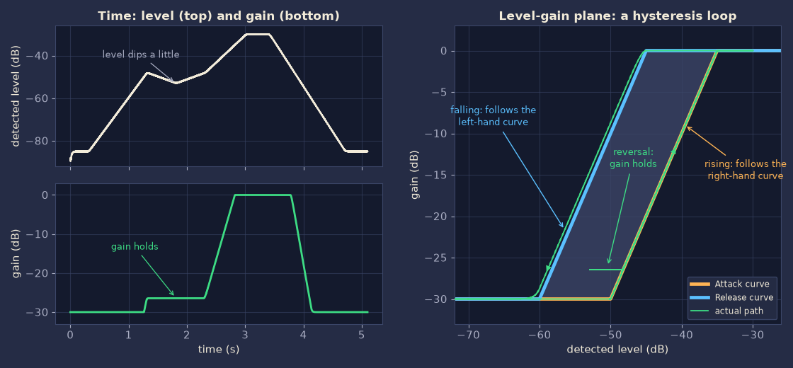

# アルゴリズム解説

AzmBezierGate の音声処理の仕組みを、[`jsfx/AzmBezierGate.jsfx`](../jsfx/AzmBezierGate.jsfx) の変数名と対応させながら説明します。使い方は [README](../README.md) を参照してください。

- 式は GitHub 上で数式として表示されます。
- 図は、この JSFX をオフラインのエミュレータ（ysfx）で実際に動かして作ったものです（図中の文字は英語）。図 3 の元になった実行では、2 章の式で計算したカーブの値が JSFX の使った値と一致することも確かめています。
- 処理は `@sample` ブロックで1サンプルごとに行います。ルックアヘッドはなく、遅延は 0 です。

## 0. 全体の流れ

```text
入力 L/R
  │
  ① ステレオリンク      a = max(|L|, |R|)
  │
  ├─ ② Peak 検知        瞬間の山を素早く捉える      … Peak Sens / Peak Release
  └─ ③ RMS 検知         短い時間の平均を見る        … RMS Sens / Window / Release
  │
  ④ 大きい方を採用      dB に変換 → 検知レベル ℓ
  │
  ⑤ カーブ評価          ℓ → ゲイン（Attack と Release の2本のカーブ）
  │
  ⑥ ヒステリシス        2本のカーブの間ではゲインを保持
  │
  ⑦ ゲイン平滑          Open / Close の時定数（dB の領域）
  │
  ⑧ ゲイン適用          L/R に同じゲインを掛ける → 出力
```

時定数 $\tau$（秒）は、サンプルレート $f_s$ を使って1サンプルあたりの係数に直して使います（`decay_of`）。1サンプルより短い時定数は1サンプルとして扱います。

$$
d(\tau) = e^{-1/(\tau f_s)},\qquad k(\tau) = 1 - d(\tau)
$$

主な記号とコードの対応です。

| 記号 | 意味 | コード |
| --- | --- | --- |
| $a$ | 左右の絶対値の大きい方 | `a` |
| $p$ | Peak 検知値 | `pk` |
| $m$ | 入力の2乗の平均 | `msq` |
| $r$ | RMS 検知値 | `rms_env` |
| $\ell$ | 検知レベル（dB） | `lvl_db` |
| $g_A,\ g_R$ | Attack / Release カーブが返すゲイン（dB） | `la`, `lr` |
| $g_{lo},\ g_{hi}$ | $g_A$, $g_R$ の小さい方 / 大きい方 | `lo`, `hi` |
| $G$ | 現在のゲイン（dB） | `gdb` |

## 1. レベル検知（①〜④）

### 1.1 ステレオリンク

$$
a[n] = \max\bigl(\lvert x_L[n]\rvert,\ \lvert x_R[n]\rvert\bigr)
$$

検知は左右をまとめて1つだけ行い、同じゲインを両チャンネルに掛けます。左右で別々に開閉すると、ステレオの定位が揺れてしまうためです。

### 1.2 Peak 検知

$$
p[n] = \max\bigl(a[n],\ d_p\,p[n-1]\bigr),\qquad d_p = d(\tau_p)
$$

$\tau_p$ は Peak Release です。

- 上がるときは即時で、入力にそのまま追いつきます。
- 下がるときは指数的に落ちます。時間 $\tau_p$ ごとに $1/e$ 倍（約 −8.7 dB）になるので、Peak Release が 10 ms なら 10 ms あたり約 8.7 dB です（図 1 の実測で 8.69 dB）。
- 波形のサンプル値のピークで、トゥルーピーク（オーバーサンプリング）ではありません。
- 周期的な信号では、山と山の間で少し落ちるため、検知値が山ごとに細かく揺れます（図 1 の赤線）。Peak Release が長いほど揺れは小さくなります。

### 1.3 RMS 検知

$$
m[n] = m[n-1] + k_w\bigl(a[n]^2 - m[n-1]\bigr),\qquad k_w = k(\tau_w)
$$

$$
r[n] = \max\bigl(\sqrt{2\,m[n]},\ d_r\,r[n-1]\bigr),\qquad d_r = d(\tau_r)
$$

RMS Window を $\tau_w$、RMS Release を $\tau_r$ とします。

- $m$ は入力の2乗を1次ローパス（指数窓）で平均したものです。
- 振幅 $A$ の正弦波の2乗平均は $A^2/2$ になります。そこで $\sqrt{2m}$ を使い、正弦波なら Peak と同じ $A$ になるように揃えています。
- 上がるときは Window に従います。
- 下がるときは、Window による低下（振幅で見て時定数 $2\tau_w$）と、Release の指数減衰のうち**遅い方**に従います。実質の時定数は $\max(2\tau_w,\ \tau_r)$ です。既定値（Window 20 ms / Release 60 ms）では Release が支配的で、10 ms あたり約 1.45 dB（= 8.69 dB / 60 ms）下がります。Window を長くして $2\tau_w$ が $\tau_r$ を超えると、Release を短くしても下がり方は変わりません。

### 1.4 感度と合成

$$
\ell = 20\log_{10}\max\bigl(g_p\,p,\ g_r\,r\bigr),\qquad g_p = 10^{S_p/20},\quad g_r = 10^{S_r/20}
$$

$S_p$, $S_r$ は Peak / RMS Sensitivity（dB）です。＋にするほど検知レベルが高く見え、小さい音でも開きやすくなります。

- Peak は歌い出しや突発音に即座に反応します。RMS は短い時間の平均で持続中の値を安定させ、語尾では Release が下がり方を緩やかにします。大きい方を採用するので、立ち上がりは速く、持続中と語尾は安定します。
- 既定値は Peak −3 dB / RMS 0 dB です。正弦波では Peak 側が 3 dB 低くなるので、定常部は RMS が決め、立ち上がりと突発音のときだけ Peak が先に反応します。
- 弱点もあります。図 1 では、単発のクリック（−35 dBFS）が Peak だけに映り、検知レベルを一瞬持ち上げています（RMS 側に出る分は約 −62 dB）。このレベルが Close を上回るなら、ゲインは開く方向に動きます。
- dB の基準は 0 dBFS（振幅 1.0）です。`log` が発散しないよう、検知値には −240 dB（振幅 $10^{-12}$）の下限があります。


*図 1：220 Hz の正弦波バースト（−30 dBFS、120 ms）と、単発のクリックに対する検知。既定値のとき。*

## 2. カーブ（⑤）

### 2.1 正規化と Range

Close / Open（dB）で検知レベルを 0〜1 に正規化します。Range は $R$ dB とします。

$$
t = \frac{\ell - \mathrm{Close}}{\mathrm{Open} - \mathrm{Close}}
$$

- $t \le 0$ のとき、ゲインは $-R$ dB。完全に閉じた状態です。
- $t \ge 1$ のとき、ゲインは 0 dB。全開です。
- $0 < t < 1$ のとき、次のベジェ曲線でつなぎます。

### 2.2 2次ベジェ曲線と Shape

始点 $P_0 = (0,\ 0)$、終点 $P_2 = (1,\ 1)$、制御点 $P_1 = (c,\ 1-c)$ の2次ベジェ曲線です。

$$
x(u) = 2c\,u(1-u) + u^2,\qquad y(u) = 2(1-c)\,u(1-u) + u^2,\qquad 0 \le u \le 1
$$

$$
c = 0.5 + 0.5\cdot\mathrm{clamp}\!\left(\frac{\mathrm{Shape}}{100},\ -0.999,\ 0.999\right)
$$

$x(u) = t$ になる $u$ を求め、そのときの $y$ からゲインを決めます。

$$
\mathrm{gain\ [dB]} = -R\,\bigl(1 - y(u)\bigr)
$$

- 制御点 $P_1$ は、点 $(0,\ 1)$ と点 $(1,\ 0)$ を結ぶ線 $x + y = 1$ の上を動きます。Shape 0% では $c = 0.5$ となって $P_1$ が対角線 $y = x$ の上に乗り、曲線は直線になります。
- Shape を＋にすると $P_1$ は対角線の下に下がり、曲線は下に膨らみます。Open の近くまでゲインが上がらず、Open 付近で急に開く「閉じ気味」の形です。
- Shape を−にすると $P_1$ は上に上がり、曲線は上に膨らみます。早めに開く形です。
- ±100% でも $\pm 99.9\%$ に抑えています。これは $c$ がちょうど 0 や 1 になる端を避けるためです。
- $0 < c < 1$ の間は $x(u)$ も $y(u)$ も $u$ に対して単調に増えます。曲線は常に「レベルが上がればゲインも上がる」形で、折り返しやループはありません。


*図 2：左は正規化したカーブ（Shape による変化）。右は既定値の2本のカーブ（Range 30 dB）。*

Shape と、Close と Open のちょうど中間のレベル $t = 0.5$ でのゲインの関係です（Range 30 dB の場合）。

| Shape | $c$ | 中間レベルのゲイン |
| --- | --- | --- |
| −100% | 0.0005 | −2.6 dB |
| −50% | 0.25 | −7.9 dB |
| 0% | 0.5 | −15.0 dB |
| +50% | 0.75 | −22.1 dB |
| +100% | 0.9995 | −27.4 dB |

### 2.3 $x(u) = t$ を閉じた式で解く

$x(u) = (1-2c)\,u^2 + 2c\,u$ は $u$ の2次式なので、解の公式で解けます。

$$
u = \frac{-c + \sqrt{c^2 + (1-2c)\,t}}{1-2c} = \frac{t}{c + \sqrt{c^2 + (1-2c)\,t}}
$$

右の形は、分子を有理化したものです。直線になる $c = 0.5$ の場合は $1-2c = 0$ ですが、右の形なら 0 で割らずに $u = t$ が得られます。コードはこの形を使っているので、場合分けも反復計算も要らず、平方根1回で済みます（`curve_db`）。

### 2.4 計算例

既定値（Range 30 dB）で、検知レベルが $\ell = -63$ dB のとき。

| カーブ | 設定 | $t$ | $c$ | $u$ | $y$ | ゲイン |
| --- | --- | --- | --- | --- | --- | --- |
| Attack | −70 / −60 dB、+50% | 0.7 | 0.75 | 0.578 | 0.456 | −16.3 dB |
| Release | −65 / −55 dB、−50% | 0.2 | 0.25 | 0.306 | 0.412 | −17.6 dB |

## 3. 2本のカーブとヒステリシス（⑥）

### 3.1 目標ゲイン

Attack / Release の2本のカーブがそれぞれ返すゲインを $g_A$ と $g_R$ とし、その小さい方を $g_{lo}$、大きい方を $g_{hi}$ とします。

$$
g_{lo} = \min(g_A,\ g_R),\qquad g_{hi} = \max(g_A,\ g_R)
$$

現在のゲイン $G$ に対して、次のように動かします。

| 状態 | 動き |
| --- | --- |
| $G < g_{lo}$ | $g_{lo}$ に向かってゲインを上げる（開く方向。時定数は Gain Smoothing Open） |
| $g_{lo} \le G \le g_{hi}$ | 動かさない（保持） |
| $G > g_{hi}$ | $g_{hi}$ に向かってゲインを下げる（閉じる方向。時定数は Gain Smoothing Close） |

言い換えると、目標ゲインは「現在のゲイン $G$ を $[g_{lo},\ g_{hi}]$ に収めた値」です。

$$
\mathrm{target} = \mathrm{clamp}\bigl(G,\ g_{lo},\ g_{hi}\bigr)
$$

2本のカーブの間（グラフで薄く塗った帯）にいる限り、ゲインは動きません。

### 3.2 どちらが開く側か：名前ではなく位置で決まる

カーブは単調増加なので、同じレベルでは、右側（Close / Open が高いレベル側）のカーブの方がゲインが小さくなります（Shape が大きく違って2本が交差する場合を除く）。そのため、

- 小さい方 $g_{lo}$ は右側のカーブの値、大きい方 $g_{hi}$ は左側のカーブの値になります。
- レベルが上がると、ゲインは**右側のカーブ**に押し上げられる形で開きます。
- レベルが下がると、ゲインは**左側のカーブ**に押し下げられる形で閉じます。

つまり、開くレベルを閉じるレベルより高くする、普通のゲートのヒステリシスです。Attack / Release という名前ではなく、位置（どちらが右側か）で、どちらが開く側になるかが決まります。

| 配置 | 開く側（レベルが上がるとき従う） | 閉じる側（レベルが下がるとき従う） |
| --- | --- | --- |
| Attack が右側 | Attack | Release |
| Release が右側（既定値） | Release | Attack |

既定値では Release の方が右側にあります（Attack −70 / −60 dB、Release −65 / −55 dB）。したがって、既定値では Release が開く側、Attack が閉じる側です。また、Shape が逆向き（Attack +50%、Release −50%）なので、2本は両端では離れ、中間で近づきます。帯の高さ $g_{hi} - g_{lo}$ は、検知レベル $\ell$ が $-65$ dB と $-60$ dB のときに約 7.9 dB、最も狭い $-62.5$ dB 付近で約 1.1 dB です。

Shape を大きく変えて2本が交差すると、交差するレベルで帯の高さが 0 になり、そのレベルでは保持が効きません（交差の前後では、値の小さい方が $g_{lo}$、大きい方が $g_{hi}$ として扱われます）。2本を完全に重ねる（Sync、後述）と、どのレベルでも帯がなくなり、カーブ1本とゲイン平滑だけの動きになります。

### 3.3 なぜヒステリシスか

検知レベルは、RMS のわずかな揺れや声の揺らぎ、息の成分などで細かく上下します。カーブが1本だと、レベルが閾値付近で揺れるたびにゲインも揺れ、音が震えます。帯があれば、帯の中の揺れではゲインが動きません。

図 3 は、レベルを上げていく途中でいったん少し下げ、また上げ、最後に下げていく様子です（見やすいように、Attack を右側に置いた配置：Attack −50 / −35 dB、Release −60 / −45 dB、どちらも Shape 0%、Range 30 dB）。

- 上がるとき、ゲインは右側のカーブ（Attack）に沿って開きます。
- レベルが少し下がり始めると、ゲインはその高さで止まり、レベルがまた右側のカーブに届くまで保持されます。
- 下がるとき、ゲインは左側のカーブ（Release）に沿って閉じます。右のグラフで緑の線が左側のカーブより少し上にずれているのは、Gain Smoothing Close（15 ms）による遅れです。



*図 3：ヒステリシスの動き。左は時間軸、右は「レベル―ゲイン」の平面での軌跡（実際の JSFX の出力）。*

## 4. ゲイン平滑（⑦）

現在のゲイン $G$（dB）を、次のように1次平滑して更新します（`k_open`, `k_close`）。

$$
G \leftarrow
\begin{cases}
G + k_o\,(g_{lo} - G + \varepsilon) & (G < g_{lo})\\
G + k_c\,(g_{hi} - G - \varepsilon) & (G > g_{hi})\\
G & (\text{otherwise})
\end{cases}
\qquad k_o = k(\tau_o),\quad k_c = k(\tau_c)
$$

Gain Smoothing Open を $\tau_o$、Close を $\tau_c$ とします。ゲインは最後に倍率へ直して、両チャンネルに掛けます。

$$
\mathrm{gain} = 10^{G/20}
$$

- 平滑は dB の領域で行います。30 dB の変化でも 3 dB の変化でも、差の $1 - 1/e$（約 63%）を縮めるのにかかる時間は同じ $\tau$ です。
- 開く向きと閉じる向きで時定数を分けられます。既定値は Open 1 ms（歌い出しを逃さない）、Close 15 ms（語尾を滑らかに）です。Open を短くしすぎると、ゲインの急な立ち上がりがクリックとして聞こえることがあります。
- 状態は $G$ そのものなので、帯の中では $G$ が止まり、平滑も働きません。
- $\varepsilon$（コードでは `eps_db`。値は $10^{-9}$ dB）は、目標をほんの少し行き過ぎた点に向かわせるための量です。目標そのものに向かう1次平滑は、目標に無限に近づくだけで到達しません。そこで $\varepsilon$ だけ先を狙うことで、有限の時間で $G$ が帯の端に届いて止まるようにしています。また、全開（0 dB）に近づく場面で値が限りなく 0 に近づき続け、デノーマル数による負荷が出ることも避けられます。
- ゲインが 0 dB（入力と同じ音量）を超えることは実質ありません。超えても $\varepsilon$ の分だけで、最大 $+10^{-9}$ dB です。

## 5. Sync（一時モード）

Sync は、Release カーブの代わりに Attack の値を使う一時的なモードです。

- 実際に使う Release カーブの値（`e_close`, `e_open`, `e_shape`）を、Sync が On なら Attack の値、Off なら Release のスライダーの値から選びます（`update_coefs`）。
- Release のスライダー（`r_close`, `r_open`, `r_shape`）は書き換えません。そのため、Sync を Off にすれば、別々に調整していた値がそのまま戻ります。プロジェクトやプリセットにも、Release の値はそのまま残ります。
- On の間は2本のカーブが一致するので、帯がなくなり、「カーブ1本＋ゲイン平滑」の動きになります。
- On の間にオートメーションなどで Release の値が変わっても、値は保存されますが、音には反映されません。

## 6. 初期化と境界条件

| 場面 | 動作 |
| --- | --- |
| 最初のサンプル | JSFX の初期化（読み込み、再生開始など）後の最初のサンプルでは、そのときの検知レベルに対応するゲイン（2本のうち小さい方）から始める。突然の開閉を避ける。 |
| 無音 | 検知値は −240 dB の下限になり $t \le 0$ なので、Range 分だけ閉じる。 |
| Range = 0 | カーブは常に 0 dB なので、素通しになる。 |
| Close ≥ Open | 幅 0.01 dB の急峻な段差として扱う（`max(Open − Close, 0.01)`）。GUI は Close < Open を保つ。 |
| サンプルレート | 時定数は ms で指定し、サンプルレートに合わせて係数に直す。22.05〜192 kHz で動作を確認。 |
| ブロックサイズ | 処理はサンプル単位で、ブロックサイズに依存しない。係数の更新だけがブロックの先頭で行われるので、GUI 操作の反映は最大でも1ブロック分の遅れになる。 |

## 7. GUI との分担

`@gfx`（GUI）は、`@sample`（音声処理）とは別のスレッドで動きます。そのため、次のように分担しています。

- GUI が書き換えてよいのは、スライダーの変数、メーター用の `m_*`（読んだあとに 0 に戻す）、再計算の要求フラグ `ui_dirty` だけです。`pk`、`gdb`、`lo`、`hi` など DSP の内部状態は書き換えません（GR の表示のために `gdb` を読むだけです）。
- GUI でパラメーターを変えると、スライダーの値を更新してホストに通知し、`ui_dirty` を立てます。係数の再計算は、音声側の `@block` の先頭で行います。
- Peak / RMS / 検知レベルのメーターは、`@sample` が前回の描画以降の最大値を `m_pk`、`m_rms`、`m_lin` に貯め、GUI が描画のたびに読み出して 0 に戻します。GR は最大値を貯めず、GUI が `gdb` の現在値を読みます。
- Meter Min / Meter Max は、グラフの横軸と Peak / RMS バーの範囲を決める表示用の設定です。音の処理には関係しません。

## 8. 計算量

1サンプルあたり、平方根が最大3回（RMS に1回、2本のカーブに各1回）、`log` が1回、`exp` が1回で、あとは四則演算と比較だけです。2本のカーブの逆算に反復計算はありません。ルックアヘッドがないので、遅延は 0 サンプルです。

## 9. パラメーターの効き方（早見）

アルゴリズム上、各パラメーターは次のように効きます。

| パラメーター | 効き方 |
| --- | --- |
| Range | 閉じたときの減衰量。カーブの縦のスケールになるので、同じ Shape でも dB あたりの傾きが変わる。 |
| Close / Open | 開き始めるレベルと、全開になるレベル。右に動かすほど、小さい音が抑えられる。間隔を狭めるとゲートらしい切れの良い動きに、広げると緩やかな動きになる。 |
| Shape | ＋で Open 付近まで閉じ気味、−で早めに開く。 |
| 2本のカーブの間隔 | 広いほどヒステリシス（ゲインを保持する帯）が広がる。 |
| Peak Sens / Release | 突発音や立ち上がりでの開きやすさと、その検知値を保つ長さ。 |
| RMS Sens / Window / Release | 持続中の開きやすさ、検知の滑らかさ（Window）、語尾で検知値が下がる遅さ。下がる遅さは $\max(2\tau_w,\ \tau_r)$。 |
| Gain Smoothing Open / Close | ゲインが開く・閉じるときの滑らかさ。 |

## 10. 限界と今後

- フルバンドのゲイン制御です。周波数帯ごとの処理はしません。
- ルックアヘッドがないため、歌い出しの手前を先読みして開くことはできません。その代わり、遅延は加わりません。
- Peak はサンプルピークで、サイドチェインもありません。
- 検知器の組み合わせ（現在は大きい方を採用）や、突発ノイズへの対処は、聴き比べながら見直す予定です。
